# Digital Forensics: Final Project
For this project, the data file `Project_08-1_Partition_Recovery.E01` has been utilized. This data file has not been included due to size limitations on GitHub, but if you are interested in finding it you may refer to the online textbook *Guide to Computer Forensics and Investigations (Seventh Edition)* by Bill Nelson, Amelia Phillips, Chris Steuart, and Robert S. Wilson. Autopsy and OSForensics have been used for this project as each gives an in-depth look at recovered files on the partition image and cover each others' limitations (such as OSForensics only allowing 12 marked case items).

# Evidence
The evidence found in `Project_08-1_Partition_Recovery.E01` varies greatly. Some items found include the following:

1. Images of random locations along the coastline.
2. Images of a supposed horse derby track.
3. Images of cycles back in 1889.
     - These images were found to be corrupted, but were traced back to the [original source](https://publicdomainreview.org/collection/cycling-art/), which is a book about cycling created in 1889 by Robert P. Scott titled *Cycling Art, Energy, and Locomotion: A Series of Remarks on the Development of Bicycles, Tricycles, and Manmotor Carriages*.
5. Employee time sheet templates.
6. Cryptocurrency tracking.
7. Bitcoin tracking.
8. Horse betting tracking.
9. Downloads of different text files.
     - These text files were found to be corrupted, but were traced back to the [original source](https://www.gutenberg.org). Many different files were downloaded from this site.

# Reports
To see the reports, please click on the following hyperlinks.

1. [Autopsy Report.](https://crats320.github.io/dfProject/autopsyReport/report.html)
      - This report contains every tagged file of interest. Files can be downloaded and previewed.
2. [OSForensics Report.](https://crats320.github.io/dfProject/osForensicsReport/Case%20Report/Full%20Length%20Report/report.html)
      - This report contains a small amount of tagged files of interest. Files can be downloaded and previewed.

Reports are hosted using GitHub pages and all files are safe to download. Some may be corrupted.

# Reflection
During this project, things went as expected for the most part. When I was initially figuring out what programs to use, I struggled to find one that would complement and work together with OSForensics effectively. Autopsy was what I settled on as it is quite similar but not limited in its report capabilities. I also had some trouble mounting the partition image for a bit, as I was trying to mount it like a physical disk. Once I realized that I was trying to run the process with a physical disk and not a virtual image, the problem was fixed. Another issue I found was that there were a handful of image files that were corrupted. Although I could not restore these images, I found the original source of these images according to the metadata of the original downloads. My final challenge during this project was the Zone Identifiers. I could not quite figure out what they were for without some extra research, but after I understood what they were for I was able to continue digging into the recovered partition. 

I would recommend this approach to others if they wish to investigate the files of a recovered drive or partition. OSForensics in particular was handy for me as I am comfortable with the program. Autopsy was good for extra sleuthing as well as marking items to generate a report for. 

# Process
To start this process, you'll need to create a case on OSForensics. Make sure to name the case and put your name on it, and change any settings as needed. 
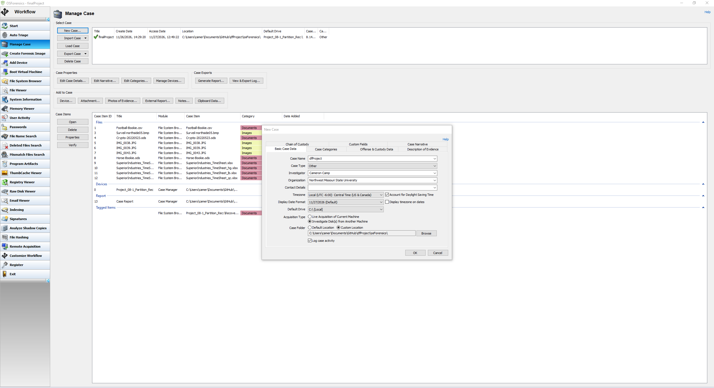

Once your case is created, you'll need to mount your image of the partition. Go to manage case, add device, and select image in the options. Then navigate to your image and select it for mounting. 
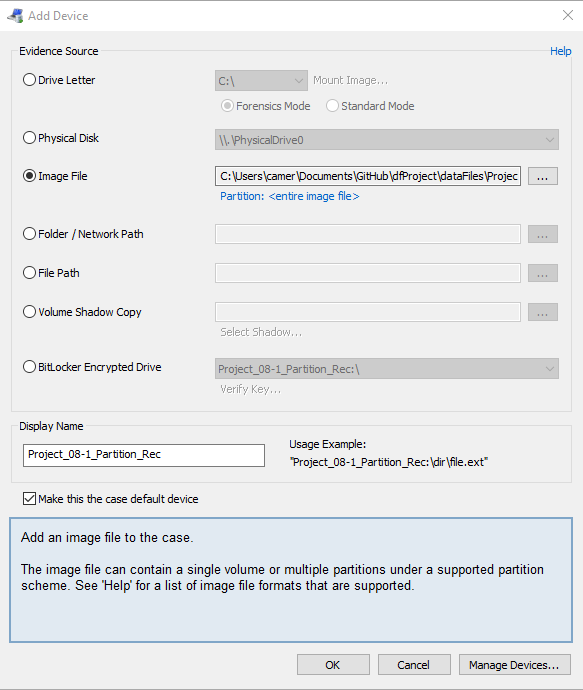

Now that your image has been mounted, you can begin to look through the tree in the File System Browser to find suspicious items. 
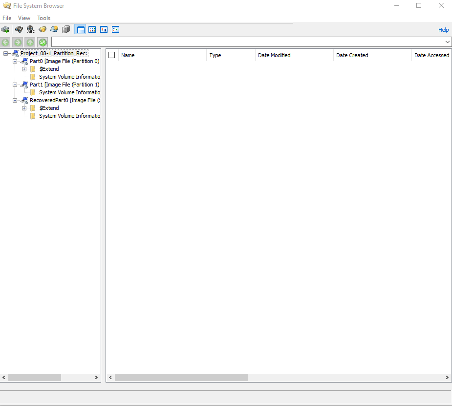
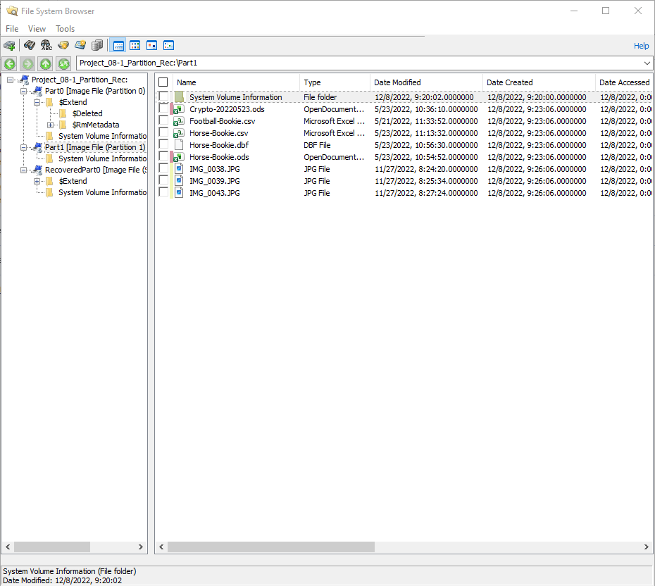

Find a suspicious item. When found, checkmark the item and then right click it to begin adding it to marked items. 
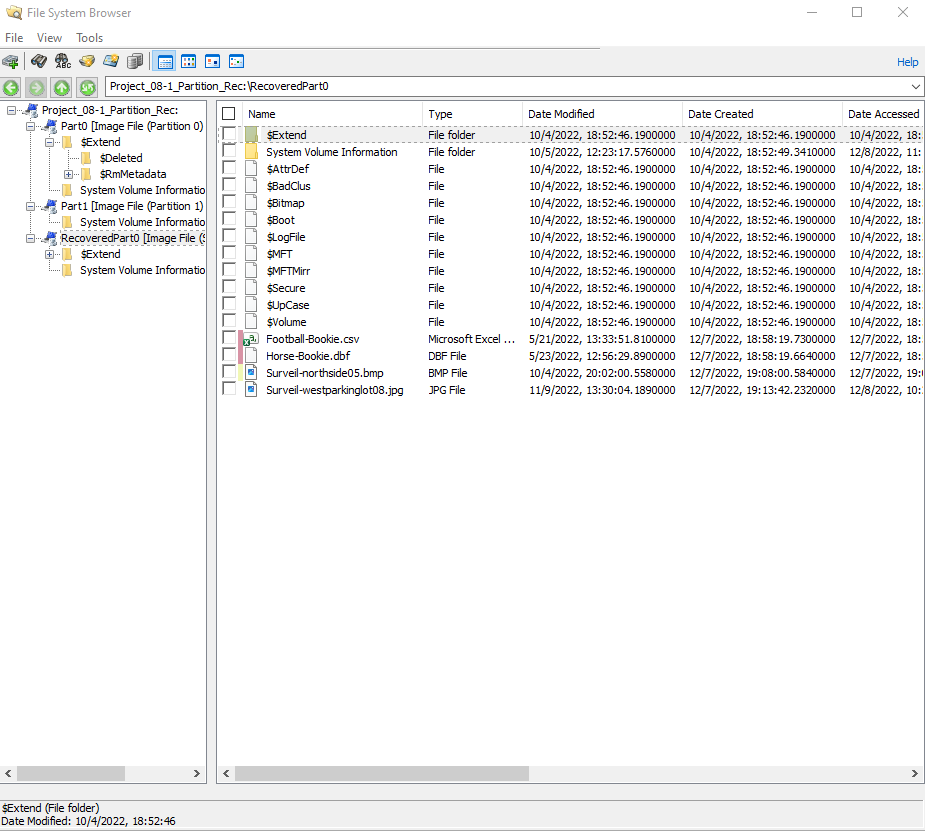
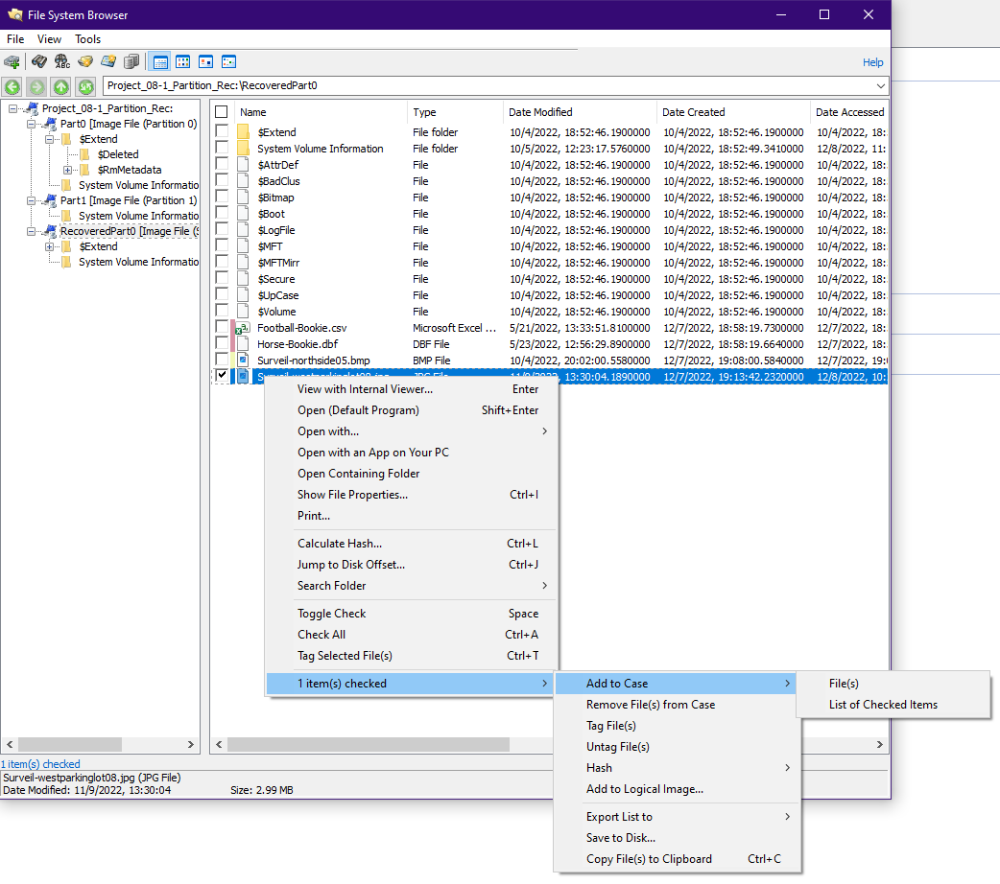

When you click "Add to case", a menu will pop up instructing you to label the item and note it. Make sure to do both things before continuing. 
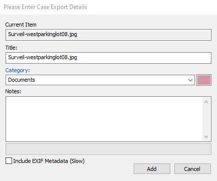

Once you have either hit the limit of items you may add to your case or finished finding all of your case items, navigate back to the start menu. Click on generate report. 
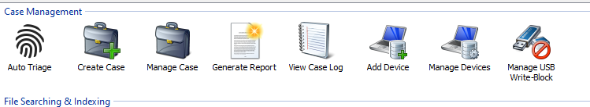

Go through the steps of the report as needed, you should not need to change anything. Once it has been generated all files should be saved locally on the computer. 
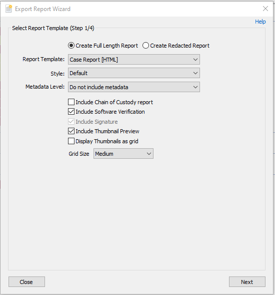

___

After generating a report on OSForensics, you can close it and open Autopsy. With Autopsy open, you can create a new case. Name it and find a good location for your project as needed, as well as number it. 
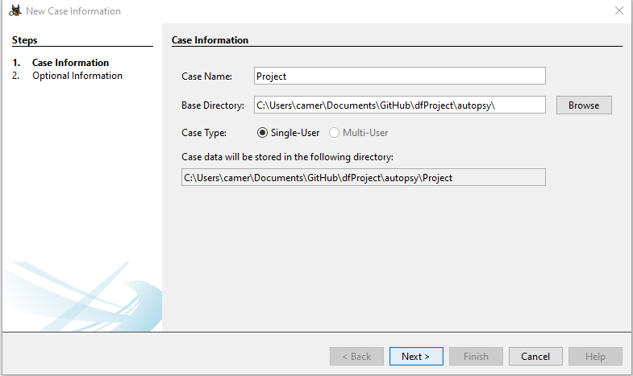
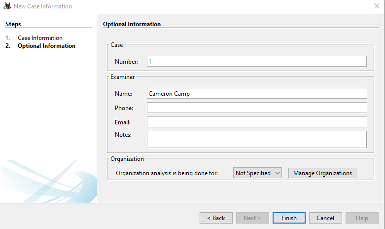

Now that your case has been created, you can now mount the partition image as well. Go through the default process and ensure you have the VM Disk/Image option selected. 
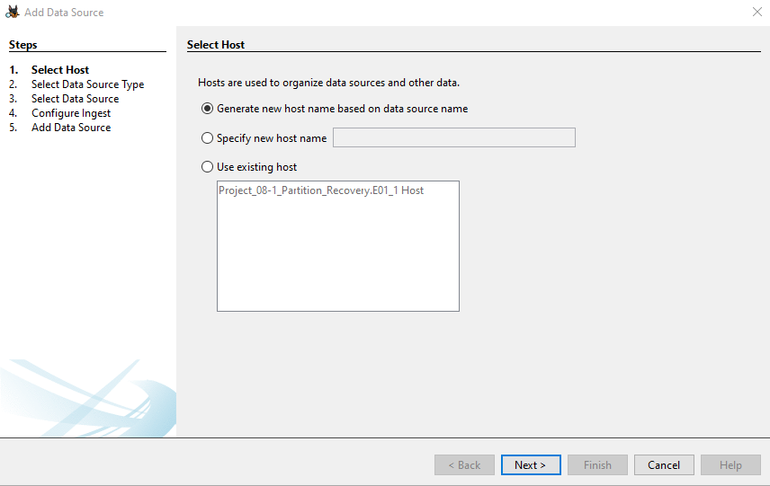

Once your image has been mounted, wait for it to ingest. After it has been ingested, you may begin to navigate through the tree and look through the files of the partition. These files are listed on the right. 
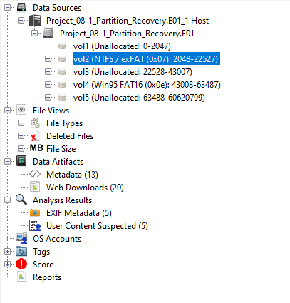

The files listed here are a preview of items you may find and add to your case. Due to screenshot limitations, I cannot include the image of adding the file to the case. 
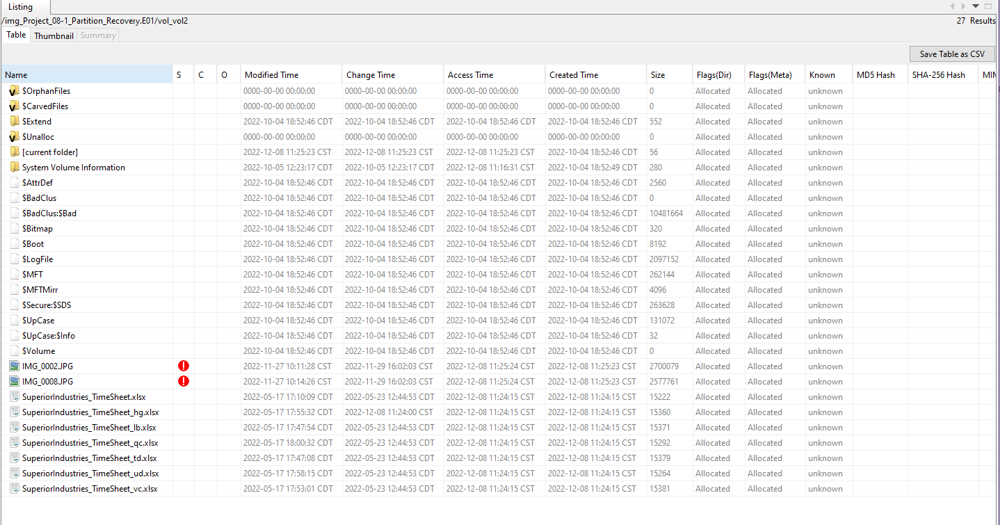

Some files may be corrupted, like the one here. In cases like these, you can look at the context of the image as well as its zone identifier to learn more about the source. 
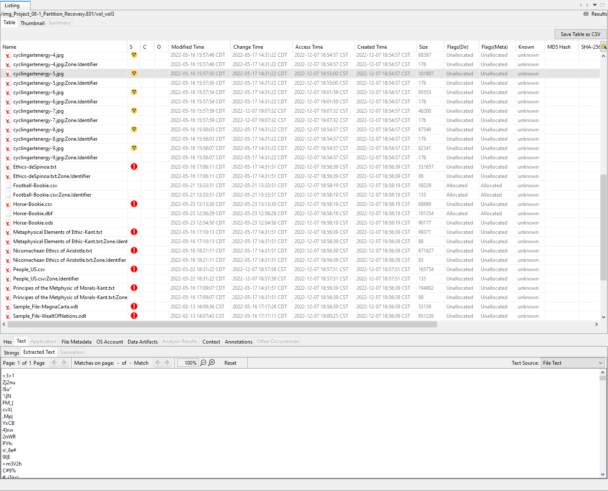
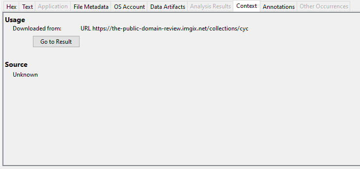
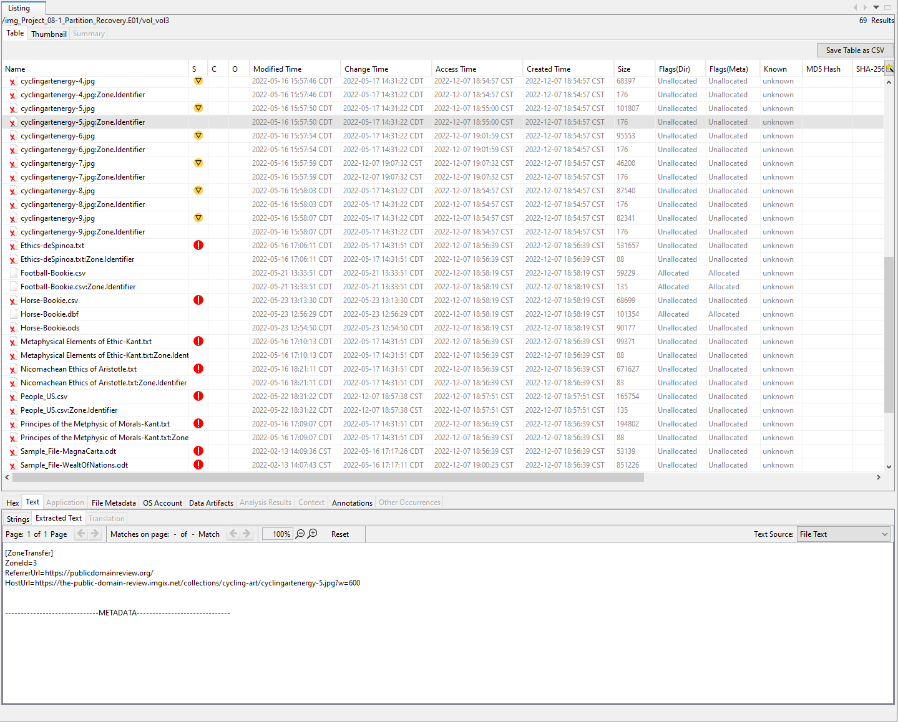

Once you have added all of your files to your case, you can now generate your report. You will follow the same process as before, use the default generation settings and let the report generate. The report will be saved locally. 
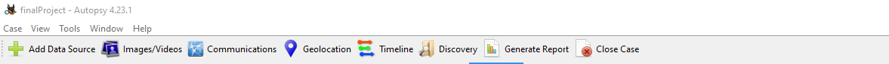
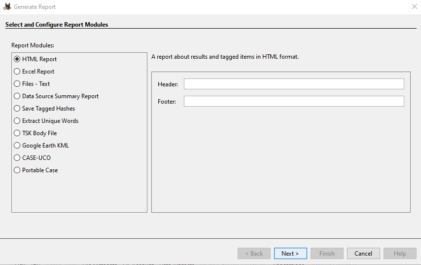

___

Now that you've finished going through everything, you can push your commits to GitHub (if you haven't already). 
